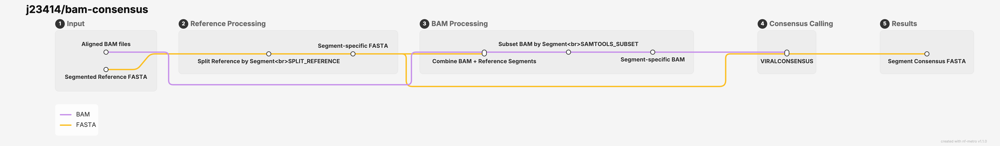

# bam-consensus

A modular workflow for generating the consensus sequence from alignment information.



## Usage

```
nextflow run j23414/bam-consensus \
  --bam [path/*.bam] \
  --samplesheet [path/bam_samplesheet.csv] \
  --reference [path/reference.fasta] \
  --outdir "consensus-results" \
  -profile stjude
```

## Samplesheet

Each line of the samplesheet will be run in parallel. Therefore, for each genome segment, provide the reference Id in the a "reference" column.

| sample | bam | reference |
| :--|:--|:--|
| Alice | bwamem2_mem/Alice.bam | GenBank_HA |
| Alice | bwamem2_mem/Alice.bam | GenBank_NA |
| Bob | bwamem2_mem/Bob.bam | GenBank_HA |
| Bob | bwamem2_mem/Bob.bam | GenBank_NA |
| Bob | bwamem2_mem/Bob.bam | GenBank_PB2 |
| Charlie | bwamem2_mem/Charlie.bam | GenBank_NS |

